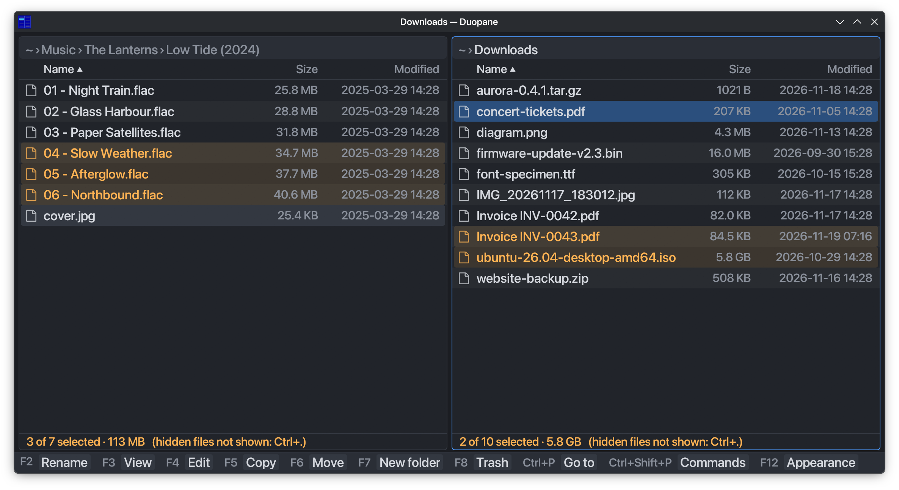

# Duopane

A fast, keyboard-driven, dual-pane file manager for Linux, written in Rust.

It works the way fman does (two folders side by side, a fuzzy "Go to" and a
command palette, everything a keystroke away) and adds the power tools Double
Commander users rely on:

- **F-key commands** for rename, view, edit, copy, move and pack, shown in a bar
  at the bottom (hold Alt, Shift or Ctrl to see the rest)
- **Copies and moves in the background**, with Double Commander's overwrite
  choices when a file is already there (Overwrite All Older, Compare by content…)
- **Zip and tar archives you browse like folders**
- **Batch rename** with patterns and regular expressions, with undo
- **A built-in viewer** (F3) for text, code, pictures, PDFs, Markdown, music and video
- **Drag and drop** between the panes and with other apps, natively on Wayland
- **Colour schemes, any installed font and weight**, and keys you can rebind

**Download:** an AppImage from the [Releases](https://github.com/rymdimperiet/duopane/releases)
page, or build it yourself (below).



## Build and run

You need Rust (https://rustup.rs). On Linux you also need the ALSA development
package for sound (`libasound2-dev` on Debian/Ubuntu, `alsa-lib` on Arch,
`alsa-lib-devel` on Fedora). Then, in this folder:

```sh
cargo run --release                 # opens your current folder and your home folder
cargo run --release -- ~/Downloads ~/Documents   # choose the two folders
cargo test                          # run the tests
```

The finished program is `target/release/duopane`. Copy it anywhere on your `PATH`.

### AppImage (one file that runs on most Linux systems)

    sh packaging/build-appimage.sh

makes `target/appimage/Duopane-<version>-x86_64.AppImage` (it downloads the
official `appimagetool` the first time if it isn't installed). An AppImage runs on
systems with the same or a newer C library than the one it was built on, so for
the widest reach let GitHub build it on an older Ubuntu: create a release with a
version tag such as `v0.2.0` and the "Release AppImage" workflow attaches the
AppImage to it, or start that workflow by hand from the repository's Actions tab.
PDF and video previews still need poppler and ffmpeg on the computer that runs it.

## Using it

| Keys | What it does |
| --- | --- |
| Up / Down / PgUp / PgDn / Home / End | Move the cursor (hold Shift to select while moving) |
| Space or Insert | Select / deselect the item under the cursor |
| Type letters | Jump to the first name that matches |
| Enter | Open a folder or **step into an archive** (.zip, .tar, .tar.gz), or open a file with its usual app |
| Shift+Enter, Shift+F10 | The right-click menu for the file under the cursor (shows each item's key) |
| Ctrl+Enter | Open with… (pick an app; also in the right-click menu) |
| Left, Alt+Left, Backspace, mouse back button | Go up to the parent folder |
| Right, Alt+Right, mouse forward button | Go down into the folder under the cursor |
| Numpad + | **Select by mask** (like Double Commander): `*.jpg;*.png`, `*.txt \| readme*` (after `\|` excludes), `src*/` (ending in `/` matches folders) |
| Numpad − | Deselect by mask (folders too, so `*` clears the whole selection) |
| Numpad * | Invert the selection |
| Tab | Switch to the other pane |
| Alt+F1 / Alt+F2 | **Drive menu** for the left / right pane: home, bookmarks, drives, drives to mount, and SFTP servers (see below) |
| Ctrl+P | **Go to** a folder: type part of its name, or a path like `~/Doc` (Tab completes) |
| Ctrl+Shift+P | **Command palette**: every command, searchable |
| Ctrl+F or Alt+F7 | **Find files** by name (see below) |
| Ctrl+Q | **Quick view**: details of the item under the cursor in the other pane (Ctrl+Q again or Tab closes it) |
| F5 / F6 | Copy / move to the other pane (you can edit the destination) |
| Ctrl+C / Ctrl+X / Ctrl+V | Copy / cut files, and paste them into the folder in the active pane (also to and from other apps; see below) |
| F2 or Shift+F6 | Rename (with several files selected: batch rename) |
| Alt+F5 | **Pack** (compress) the selection into a ZIP, TAR.GZ or TAR archive |
| Alt+F9 | **Unpack** the selected archives |
| Ctrl+M | **Batch rename** the selection (or the whole folder) |
| F7 | New folder (`a/b/c` makes nested folders) |
| Shift+F4 | New file |
| F3 | **Lister**: view the file (see below); on a folder, a tree of everything in it |
| F4 | Edit the file |
| F8 or Delete | Move to the trash |
| Shift+F8 or Shift+Delete | Delete permanently |
| Ctrl+1 / 2 / 3 / 4 (or Ctrl+F3 / F4 / F5 / F6) | Sort by name / type / date / size (press again to reverse) |
| Ctrl+. or Ctrl+H | Show / hide hidden files |
| Ctrl+L | Type a location |
| Ctrl+B | Bookmark this folder (bookmarks rank first in Go to) |
| (command palette) | History: previous / next folder |
| Ctrl+Left / Ctrl+Right | Open the folder under the cursor in the left / right pane |
| Ctrl+Shift+M | Show this folder in the other pane |
| Ctrl+U | Swap the panes |
| Ctrl+Shift+C | Copy the selected paths to the clipboard |
| Ctrl+Shift+S | Calculate the size of the selection |
| F9 | Open a terminal here |
| Ctrl+Plus / Ctrl+Minus | Bigger / smaller text |
| Ctrl+, | Edit the settings file |
| F12 | **Appearance**: colour scheme, fonts, text size, striped rows, the “..” row |
| F1 / Shift+F1 | Keyboard shortcuts / About Duopane |
| F10 | Quit |
| F1 | List every shortcut |

Hold Alt, Shift or Ctrl to see what the F-keys do with that key in the bar at
the bottom (for example Alt: Pack and Unpack; Ctrl: the sort keys).

The mouse works too: click, Ctrl+click and Shift+click select, a double-click opens,
right-click opens a menu, and clicking a column header sorts by it.

### Drag and drop

- **Between the panes:** drag a file (or a selected group) onto the other pane, or
  onto any folder (`..` too). The usual Copy dialog opens with the destination
  filled in; press Enter. Hold **Shift** when you let go to move instead (the
  pointer loses its plus, like in Double Commander). Escape cancels a drag.
- **Out to other apps** (a browser, mail, Dolphin…): on a Wayland desktop, just
  drag the files onto the other app, even one that overlaps Duopane's window,
  and drop them. Hold Shift over a file manager to move them there instead (the
  file manager does the moving; Duopane itself never deletes anything when a
  drag ends).
  This is new and experimental: if it misbehaves, start Duopane with
  `DUOPANE_NO_NATIVE_DRAG=1` to turn it off, and `DUOPANE_DEBUG_DRAG=1` to see what
  happens on the terminal. On X11 (or as a fallback), right-click → *Drag to
  another app…* opens the files in a small drag window instead; that needs
  [ripdrag](https://github.com/nik012003/ripdrag) or
  [dragon-drop](https://github.com/mwh/dragon) installed.
- **In from other apps:** drop files on a pane and the Copy dialog opens with
  that pane's folder filled in. This works on Wayland and X11.

### Copy and paste

Ctrl+C (or Ctrl+X to cut) puts the selected files on the clipboard; Ctrl+V in
any folder copies them there (or moves them, after a cut), with the usual
questions when something's already there. Pasting into the folder they came
from makes copies ("name copy.txt").

On Wayland the files go on the system clipboard the way file managers put them
there, so they paste into Dolphin, Files, a browser's upload box or mail, and
files copied or cut in those paste into Duopane. A file manager that pastes cut
files moves them itself; Duopane never deletes anything because another app said
so. Elsewhere the paths go on the clipboard as text, and Ctrl+V works within
Duopane.

Copies and moves run in the background with a progress bar; you can cancel them
and start more (they queue up).

When a file is already there, the job pauses and shows both files (path, size,
date) with Double Commander's choices: **Overwrite**, **Skip**, **Rename…** (give
the new file another name), **Overwrite All**, **Skip All**, **Compare by
content** (are they identical?), **Overwrite All Older**, **Cancel**, and under
**Other**: overwrite all smaller or all larger, or auto-rename all new or all
existing files. The "All" choices apply to the rest of that job. The keyboard
focus starts on Skip, so a stray Enter never overwrites anything. Folders that
meet are merged, and you're asked about each file inside. The same applies to
unpacking archives and copying files out of them.

## Finding files (Ctrl+F)

Type a few words and results appear as they're found. Every word has to appear
in the name or the path below the folder you're in, in any order, upper or lower
case; no regular expressions needed. `holiday jpg` finds
`Pictures/Holiday 2026/IMG_4411.jpg`. Names that match best come first.

- **Tab** widens the search: this folder → your home folder → everywhere.
- **Enter** goes to the selected file: its folder opens with the cursor on it.
- **Ctrl+Enter** (or ↓ past the last result to the buttons, then Enter on *Show
  all in the pane*) shows all results in the pane, like a folder ("feed to listbox"):
  select, copy, move, delete, view or rename them as usual. The path bar says
  what was searched; Backspace or `..` goes back to the folder.
- A few filters, each starting with a symbol so they never clash with names:
  `*.pdf` (a mask), `>10mb` and `<1kb` (size), `@today`, `@yesterday`, `@week`,
  `@month`, `@2025`, `@2025-11` (when it was changed), `@folders`, `@files`.

When [plocate](https://plocate.sesse.net/) is installed (most distributions have
it), its index gives results in a moment, while Duopane also looks through the
folder itself for anything newer than the index. "Everywhere" uses the index
alone and says how old it is. Hidden files are searched when they're shown
(Ctrl+.).

## Drives and places (Alt+F1 / Alt+F2)

Where the old commanders let you pick a drive letter, Duopane lists:

- **Places:** home, the root folder and the trash, plus your bookmarks (Ctrl+B).
- **Drives:** everything mounted that you'd want to open: other disks, USB
  sticks, network shares and FUSE mounts such as sshfs or rclone. The system's
  own partitions (and btrfs subvolumes) are left out. Each shows its free space.
- **Not mounted:** drives that are plugged in but not mounted yet. Enter mounts
  one (with `udisksctl`, as the desktop does) and opens it. Mounts that are
  down show here too, so you can bring them back: rclone or sshfs mounts run by
  a systemd user service (Enter starts the service; unmounting stops it), and
  FUSE mounts that Duopane unmounted (it remembers the command that mounted
  them and runs it again; Delete forgets one).

- **Network:** SFTP servers you've connected to before, and the hosts in
  `~/.ssh/config`. **Connect to SFTP…** takes `user@host:/folder`, a host name
  from your ssh config, or `sftp://host:2222/folder`.

Up/Down and Enter pick, a letter jumps to the next name starting with it,
Left/Right move the menu to the other pane, and Delete unmounts a USB stick or
your own FUSE mount (on a recent server: forgets it). A mark shows which place
each pane is in.

SFTP servers are mounted with `sshfs` (install it from your distribution)
under `~/.cache/duopane/mounts/`, so they work like any other folder: copy,
Quick view and search all work there. Your ssh keys and ssh agent are used
first; if they don't let you in, Duopane asks for the password, which it
never saves. As with ssh, a server you've never connected to before is
remembered the first time, and Duopane refuses one whose identity has changed
since. A connection stays up, also after Duopane closes, until you unmount it
(Delete in the menu).

Some desktops keep Alt+F1 and Alt+F2 for themselves; KDE Plasma's launcher
widget may take Alt+F1. Free the key there (System Settings → Shortcuts), or
use the command palette, or bind the menu to other keys (`places_left` and
`places_right` in the settings file).

## Open with (Ctrl+Enter)

Lists the apps that can open the selected files (or the one under the cursor),
taken from the same place the desktop's own "Open With" menus use: the apps'
`.desktop` files and your choices in `mimeapps.list`. Your default app comes
first, then the other suggestions, then every other installed app, so you can
pick any of them. Type to search the whole list. When the files are of
different kinds, only apps that suit all of them are suggested. A file's kind
is read from its name, so a file without an extension usually gets no
suggestions, just the full list.

## Quick view (Ctrl+Q)

The other pane shows what the cursor is on, and follows it as you move:

- **Everything:** kind, location, size in bytes, modified / created / accessed,
  permissions and owner (and where a link points).
- **Folders:** what's in them, and their total size, counted as you watch.
- **Photos:** a preview, the size in pixels, and the camera's details (camera,
  lens, date taken, exposure, aperture, ISO, focal length, location).
- **Music and video:** length, format, tags (title, artist, album…), and the
  cover or a frame from the video (needs ffmpeg).
- **PDFs:** pages, title, author, paper size (needs poppler).
- **Archives:** how many files are inside and their unpacked size.
- **Text:** the first lines.

## Archives as folders

Enter (or double-click, or Right) on a .zip, .tar, .tar.gz or .tgz file shows what's
inside, like a folder: move around with the usual keys, “..” or Backspace to go
back up and out. F3 views and Enter opens a file inside (it's unpacked to a
temporary folder that's removed when Duopane closes), F5 copies the selection out
to the other pane. Renaming, deleting and adding files inside an archive aren't
supported yet.

## Batch rename (Ctrl+M)

Renames the selected items (or everything in the folder) using patterns, like
Double Commander's multi-rename tool. The name and extension patterns can use
`[N]` the old name, `[N2-5]` characters 2 to 5 of it, `[E]` the extension,
`[C]` a counter (start, step and number of digits are adjustable), `[P]` the
folder's name, and `[Y] [M] [D] [h] [m] [s]` the date and time the file was
changed. Find & replace (optionally with a regular expression) and a case change
are applied after that. A live preview shows every new name and flags clashes;
"Undo the last batch rename" in the command palette puts the old names back.

## The lister (F3)

F3 opens the file under the cursor in a full-window viewer:

- **Text and code**: coloured for most programming and markup languages; UTF-8,
  UTF-16 and Latin-1; Word (.docx), OpenDocument (.odt) and RTF show their text.
  Ctrl+F finds (Enter or F3 for the next match), W wraps long lines.
- **Pictures**: PNG, JPEG, GIF, BMP, WebP, TIFF, ICO, TGA… `+`/`-` or Ctrl+wheel to zoom, `0` to fit.
  When zoomed in, the arrow keys move round the picture (PgUp/PgDn a screenful, Home/End top/bottom).
- **PDF**: page by page (←/→ or PgUp/PgDn), with zoom. ↑/↓ scroll the page and run on
  into the next or previous one, so a document reads straight through; Shift+←/→ scroll
  sideways when zoomed in. Needs poppler (`pdftoppm`, `pdfinfo`).
- **Music**: MP3, FLAC, Ogg, WAV, M4A/AAC and more, with tags and cover art.
  Space plays/pauses, Left/Right seek, Up/Down change the volume.
- **Video**: MP4, MKV, WebM, AVI, MOV… with sound. Needs `ffmpeg` and `ffprobe`.
- **Markdown** (.md): shown as a formatted page with headings, lists, tables,
  coloured code and pictures; `2` shows the source.
- **Archives** (ZIP, TAR, TAR.GZ): a list of what's inside.
- Any other file shows as hex. Keys `1` / `2` / `3` switch between preview, text and hex.

`N` / `P` show the next / previous file in the folder, Esc (or Q, or F3) closes.

### Lister plugins

Add viewers for other file types in the settings file under `lister_plugins`.
A plugin is a command that prints either text or a picture (PNG/JPEG) for a file;
`{file}` is replaced with the file's path. Plugins are tried before the built-in
viewers, and if one fails the built-in viewer is used instead. Examples:

```json
"lister_plugins": [
  { "name": "SVG picture", "extensions": ["svg"], "command": "rsvg-convert --width 1600 {file}", "output": "image" },
  { "name": "Markdown as text", "extensions": ["md"], "command": "pandoc -t plain {file}", "output": "text" },
  { "name": "7-Zip contents", "extensions": ["7z", "rar"], "command": "7z l {file}", "output": "text" },
  { "name": "ISO contents", "extensions": ["iso"], "command": "isoinfo -l -i {file}", "output": "text" }
]
```

`"syntax"` (e.g. `"json"`, `"md"`) colours text output like that kind of file.

## Appearance (F12)

Choose a colour scheme (Duopane Dark/Light, Commander Blue, Solarized Dark, Nord,
Gruvbox Dark, High Contrast) and any font installed on your computer, for the
interface and for the lister's monospace text, in any weight it's installed in
(Light, Regular, Medium, Bold…). With striped rows on, *Row contrast* sets how
much every other row stands out. Files are coloured by kind (pictures, video,
music, documents, archives, code, programs and temporary files), in colours
picked for each scheme to stay readable and apart from folders and the
selection; this can be turned off. Each name also gets a small icon for its
kind (PDF, spreadsheet, Rust, Python…), from a few Nerd Font icons bundled with
Duopane, so no special font is needed. Changes apply at once. Single colours can be
overridden in the settings file:

```json
"custom_colors": { "folder": "#ffcc00", "cursor": "#30507a" }
```

Keys: bg, pane, header, border, accent, text, dim, folder, symlink, selected,
cursor, cursor_inactive, error, ok, stripe (every other row), and the kinds of
file: picture, video, music, document, archive, code, program, temporary.

Every folder starts with a “..” row (Enter on it goes up a level); it can't be
selected, renamed, copied or deleted. Both it and the striped rows can be turned
off in Appearance, and so can the function-key bar at the bottom (also from the
command palette: “Show / hide the function-key bar”). The status line under the panes only
appears while there's a message, a file operation in progress or a name search. New schemes go in `src/theme.rs`.

## Settings

Settings live in `~/.config/duopane/settings.json` (open it with **Ctrl+,**, then
run **Reload settings file** from the command palette). Duopane remembers the
two folders, sorting, bookmarks and the folders you visit most.

Change shortcuts with `key_bindings` (command ids are in `src/commands.rs`):

```json
"key_bindings": {
  "copy": ["F5", "Ctrl+Shift+V"],
  "toggle_hidden": ["Ctrl+H"]
}
```

Add your own commands with `custom_commands`. They run in a shell and appear in
the command palette. `{path}` (item under the cursor), `{dir}` (this folder),
`{other}` (the other pane's folder) and `{selected}` (all selected items) are
replaced with safely quoted values:

```json
"custom_commands": [
  { "title": "Open in VS Code", "run": "code {dir}", "keys": ["Ctrl+Shift+E"] },
  { "title": "Zip selection", "run": "zip -r archive.zip {selected}" },
  { "title": "Compare with other pane", "run": "meld {dir} {other}" }
]
```

Set `"editor"` (for F4) and `"terminal"` (for F9) if you don't want the defaults.

## Making it your own

The code is small and split by job:

- `src/commands.rs`: every command, its title and its default shortcuts. To add a
  built-in command, add one line here and a method in `src/actions.rs`.
- `src/actions.rs`: what each command does.
- `src/pane.rs`: one folder listing (sorting, selection, history).
- `src/fs_ops.rs`: copy / move / delete on a background thread.
- `src/ui.rs` and `src/dialogs.rs`: everything that's drawn.
- `src/theme.rs`: colours and sizes.
- `src/settings.rs`: the settings file.

The window uses [egui](https://github.com/emilk/egui) through `eframe`, which runs
on Linux, Windows and macOS.

### A demo folder for screenshots

`scripts/demo.sh` builds a made-up home folder (projects, documents, holiday
pictures, music, archives…) and starts Duopane in it, with its own settings, so
screenshots don't show your real files or paths. `--rebuild` starts it over.

## Status and known limitations

Duopane is young. It's in daily use on Linux (KDE Plasma on Wayland) and has a
test suite, but expect rough edges, and please report them.

- **Linux only, for now.** egui also runs on macOS and Windows, but Duopane hasn't
  been built or tested there; the trash, opening files and dragging to other apps
  would need work.
- **Desktops:** developed on KDE Plasma (Wayland). X11 and other desktops should
  work but are less tested. On X11, dragging files to other apps goes through
  ripdrag or dragon-drop.
- **Not there yet:** searching inside files, remote locations other than SFTP
  (beyond what's already mounted), and a side-by-side file comparison.
- **The viewer leans on other tools** for some files: poppler for PDFs, ffmpeg for video.

## How it was made

Duopane was built with [Claude Code](https://claude.com/claude-code), Anthropic's
AI coding assistant. I set the direction, the design and the priorities, and use
and test it daily; most of the code was written by Claude.

## Licence

MIT; see [LICENSE](LICENSE). Duopane was written from scratch, inspired by fman and Double Commander.
The file-type icons come from Nerd Fonts' icon sets; see
[assets/icons-LICENSE.txt](assets/icons-LICENSE.txt).
